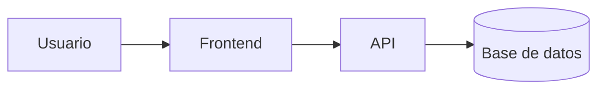
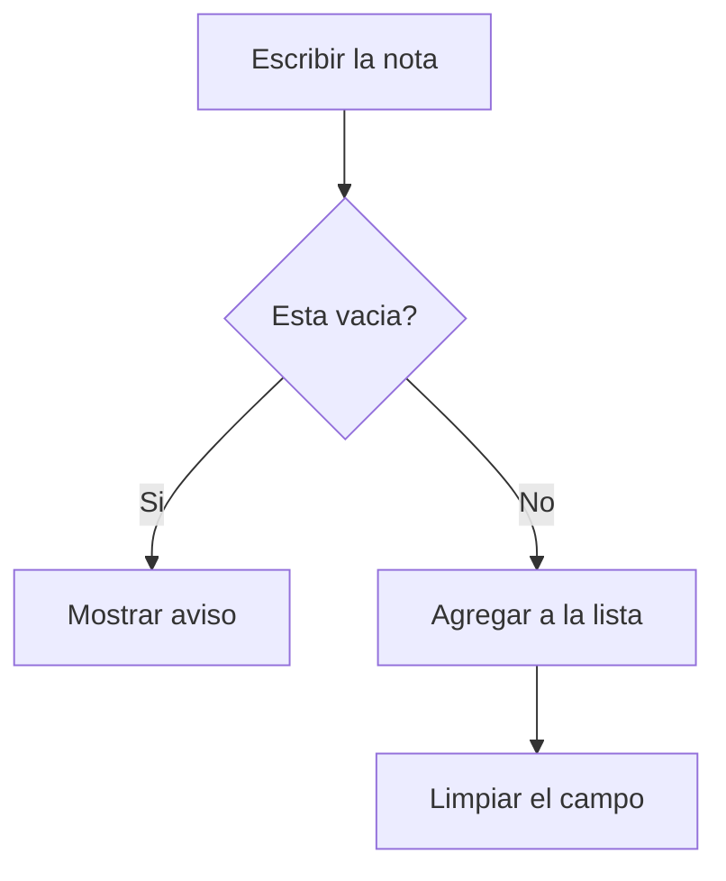

# App Notas


Aplicacion web sencilla para guardar notas desde el navegador.
Pensada para estudiantes que necesitan apuntar ideas rapidas sin
instalar ningun programa.

## Tabla de contenidos

- [Instalacion](#instalacion)
- [Uso](#uso)
- [Estado de las funciones](#estado-de-las-funciones)
- [Arquitectura](#arquitectura)
- [Contribucion](#contribucion)
- [Licencia](#licencia)

## Instalacion

```bash
git clone https://github.com/yesicamancilla-stack/app-notas.git
cd app-notas
```

## Uso

1. Abrir el archivo `index.html` en el navegador.
2. Escribir una nota en el campo de texto.
3. Hacer clic en **Agregar**.


## Estado de las funciones

| Funcion | Estado | Prioridad |
|:--------|:------:|----------:|
| Agregar nota | Listo | Alta |
| Eliminar nota | En curso | Media |
| Guardar en el navegador | Pendiente | Baja |

## Hoja de ruta

- [x] Diseno de la pantalla
- [x] Agregar notas a la lista
- [ ] Eliminar notas
- [ ] Guardar con localStorage


## Ejemplos de codigo

Estructura del formulario:

```html
<input id="nota" placeholder="Escribe una nota">
<button onclick="agregar()">Agregar</button>
```

Funcion que agrega la nota:

```js
function agregar() {
  const texto = document.getElementById("nota").value;
  console.log("Nota agregada:", texto);
}
```

Ejemplo de nota guardada:

```json
{ "id": 1, "texto": "Estudiar Markdown", "hecha": false }
```


## Arquitectura




### Flujo para agregar una nota




## Contribucion

1. Haz un fork del repositorio.
2. Crea una rama: `git checkout -b mejora/mi-cambio`
3. Guarda tus cambios: `git commit -m "Describe tu cambio"`
4. Sube la rama: `git push origin mejora/mi-cambio`
5. Abre un Pull Request explicando que mejoraste.

## Licencia

Este proyecto usa la licencia MIT. Revisa el archivo [LICENSE](LICENSE).

## Autor

Hecho por **Yesica Mancilla** - [GitHub](https://github.com/yesicamancilla-stack)
